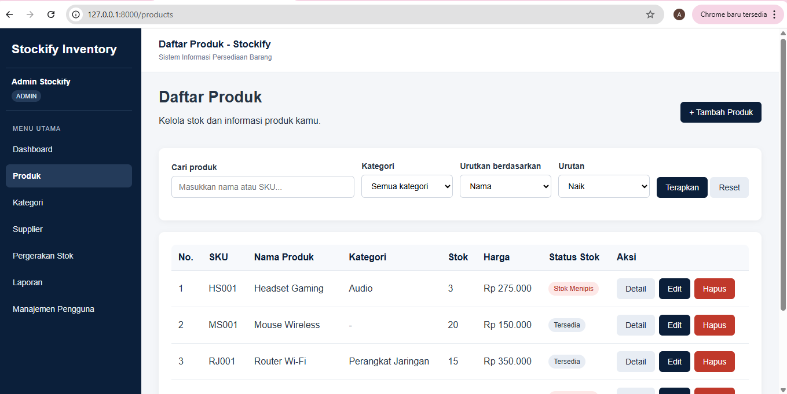
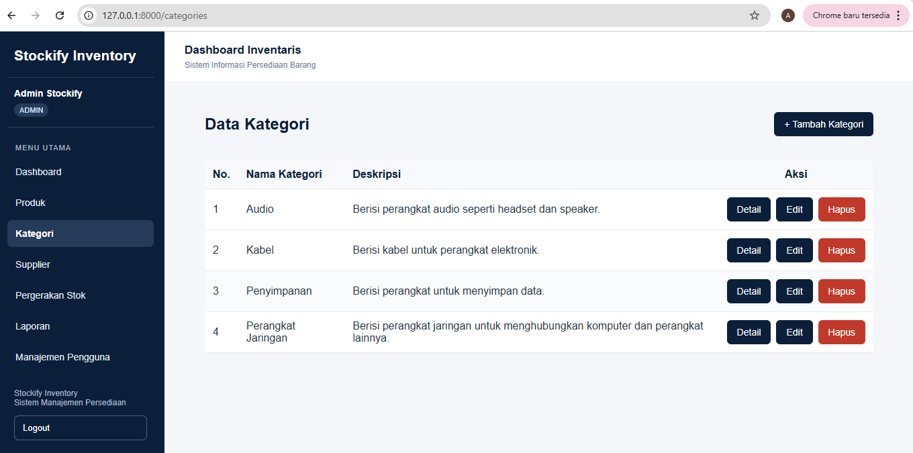
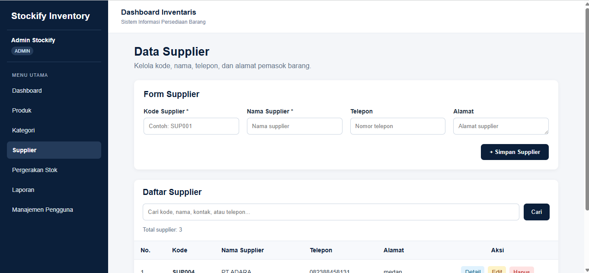
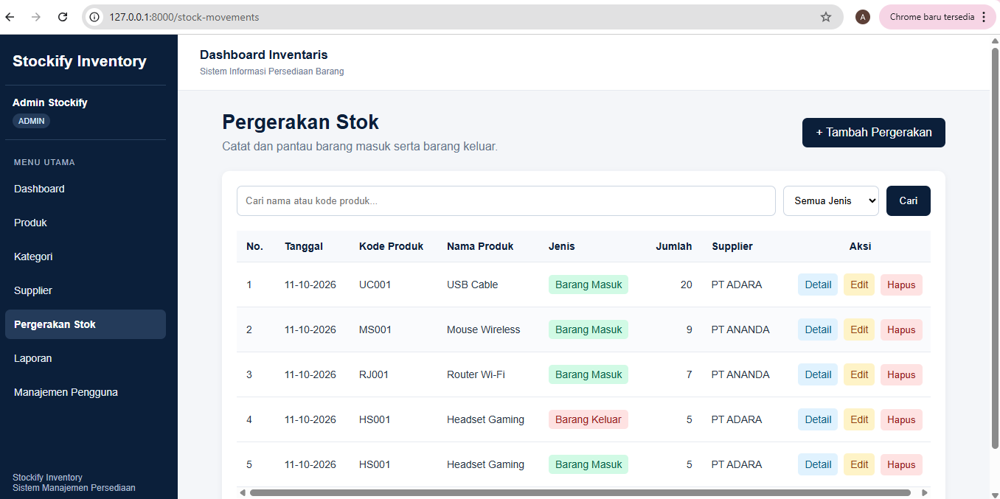
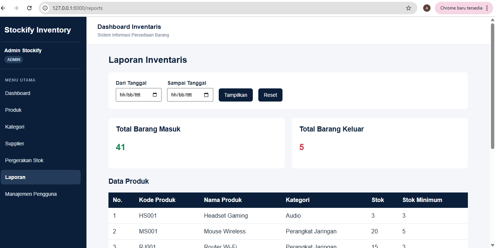
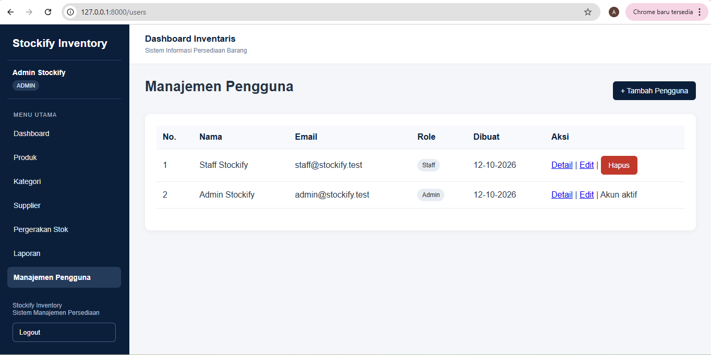

# 📦 Stockify — Inventory Management System

## 1. Deskripsi Proyek

Stockify adalah aplikasi web untuk mengelola persediaan barang. Project ini dikembangkan menggunakan Laravel sebagai kelanjutan dari Inventory Management System pada Pertemuan 4.

Aplikasi ini membantu pengguna mengelola produk, kategori, supplier, pergerakan stok, laporan, dan akun pengguna. Stockify dilengkapi dengan sistem login dan hak akses Admin serta Staff untuk membatasi akses sesuai peran pengguna.

## 2. Teknologi yang Digunakan

- PHP 8.2
- Laravel
- MySQL
- Composer
- Blade Template Engine
- Eloquent ORM
- XAMPP
- Git dan GitHub

## 3. Fitur Aplikasi

- Login dan logout.
- Hak akses Admin dan Staff.
- Dashboard informasi persediaan.
- CRUD produk dan kategori.
- Pengelolaan supplier.
- Pencatatan barang masuk dan barang keluar.
- Riwayat pergerakan stok.
- Laporan persediaan.
- Pencarian, filter, sorting, dan pagination produk.
- Validasi input formulir.
- Manajemen pengguna khusus Admin.

## 4. Arsitektur MVC

Project ini menggunakan pola MVC (*Model, View, Controller*) untuk memisahkan pengelolaan data, tampilan, dan proses aplikasi.

- **Model:** Mengelola data dan interaksi dengan database melalui Eloquent ORM.
- **View:** Menampilkan antarmuka aplikasi menggunakan Blade.
- **Controller:** Memproses request, menjalankan logika aplikasi, dan menentukan response.

Alur request aplikasi:

```text
Browser
   ↓
Route
   ↓
Controller
   ↓
Model
   ↓
Database
   ↓
Response
   ↓
Browser
```

## 5. Persyaratan Sistem

- PHP 8.2 atau versi yang kompatibel dengan project.
- Composer.
- MySQL.
- Git.
- XAMPP atau lingkungan server PHP dan MySQL yang sesuai.

## 6. Cara Instalasi

### A. Clone Repository

```bash
git clone https://github.com/AnandaElfira15/stockify-laravel.git
cd stockify-laravel
```

### B. Instal Dependensi

```bash
composer install
```

### C. Siapkan File Environment

Salin `.env.example` menjadi `.env`.

Untuk Windows CMD:

```bash
copy .env.example .env
```

Kemudian jalankan:

```bash
php artisan key:generate
```

Jika file `.env` sudah tersedia, sesuaikan konfigurasi yang ada tanpa menimpa pengaturan yang masih dibutuhkan.

### D. Siapkan Database

Buat database kosong melalui phpMyAdmin. Nama database harus sesuai dengan nilai `DB_DATABASE` pada file `.env`.

Contoh konfigurasi:

```env
DB_CONNECTION=mysql
DB_HOST=127.0.0.1
DB_PORT=3306
DB_DATABASE=stockify_laravel
DB_USERNAME=root
DB_PASSWORD=
```

Sesuaikan konfigurasi jika pengaturan MySQL berbeda.

### E. Jalankan Migration dan Seeder

Untuk database baru yang masih kosong, jalankan:

```bash
php artisan migrate --seed
```

Perintah ini membuat tabel yang belum tersedia berdasarkan migration dan menjalankan seeder untuk mengisi data awal.

**Catatan:** `php artisan migrate:fresh --seed` akan menghapus tabel yang dikelola migration sebelum membuatnya kembali. Gunakan hanya pada database yang memang boleh di-reset, bukan database berisi data penting.

### F. Jalankan Aplikasi

```bash
php artisan serve
```

Buka aplikasi melalui browser:

http://127.0.0.1:8000

## 7. Pengujian

Jalankan pengujian otomatis menggunakan:

```bash
php artisan test
```

Pada pengujian terakhir, **3 tes berhasil dengan 4 assertions**. Pengujian tersebut mencakup pengalihan pengunjung yang belum login dan akses halaman login.

Pengujian otomatis ini belum mencakup seluruh fitur CRUD. Fitur aplikasi lainnya juga diperiksa melalui pengujian manual.

## 8. Screenshot Aplikasi

Screenshot berikut merupakan dokumentasi tampilan aplikasi dan kode Laravel yang disimpan di folder `Screenshot/` pada repository.

### A. Login dan Dashboard

| Login Admin | Dashboard Admin |
|---|---|
|  |  |

| Login Staff | Dashboard Staff |
|---|---|
|  |  |

### B. Manajemen Inventaris

| Produk | Kategori |
|---|---|
|  |  |

| Supplier | Stok |
|---|---|
|  |  |

### C. Laporan dan Pengguna

| Laporan | Pengguna |
|---|---|
|  |  |

### D. Validasi Formulir

| SKU Wajib Diisi | SKU Tidak Boleh Duplikat |
|---|---|
|  |  |

### E. Route dan Routing Laravel


### F. Blade View


## 9. Repository

Source code lengkap proyek tersedia di GitHub:

**[Stockify — Inventory Management System](https://github.com/AnandaElfira15/stockify-laravel)**

## 10. Tujuan Pengembangan

Pengembangan ini bertujuan menerapkan konsep Laravel, termasuk routing, controller, model, relasi Eloquent, migration, factory, seeder, Blade, validasi formulir, dan pengelolaan data persediaan.

Pengembangan dari Pertemuan 4 ke Pertemuan 5 dilakukan dengan mempertahankan fungsi utama sistem persediaan barang sekaligus menerapkan struktur dan fitur yang tersedia pada framework Laravel.