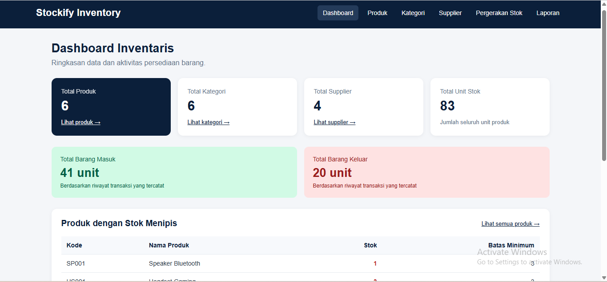
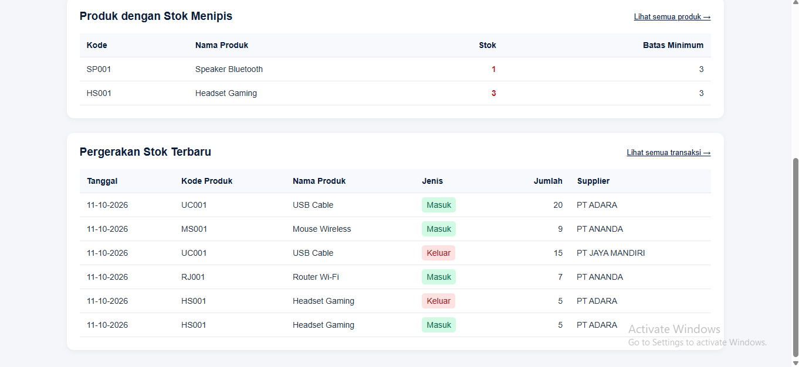
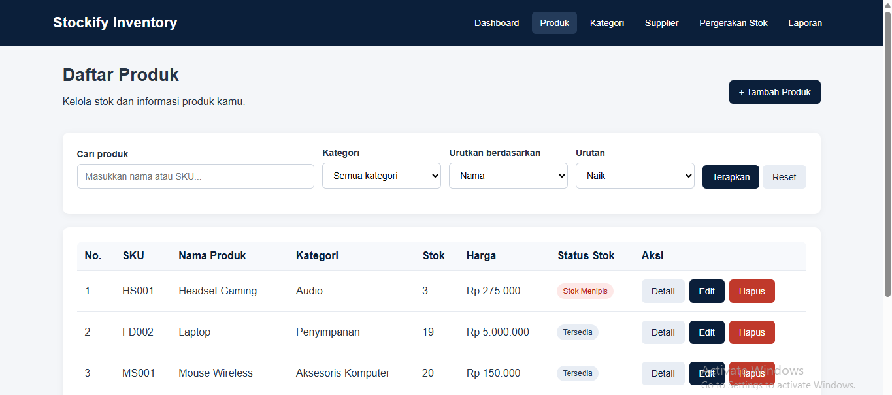
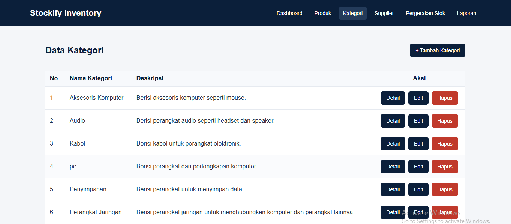
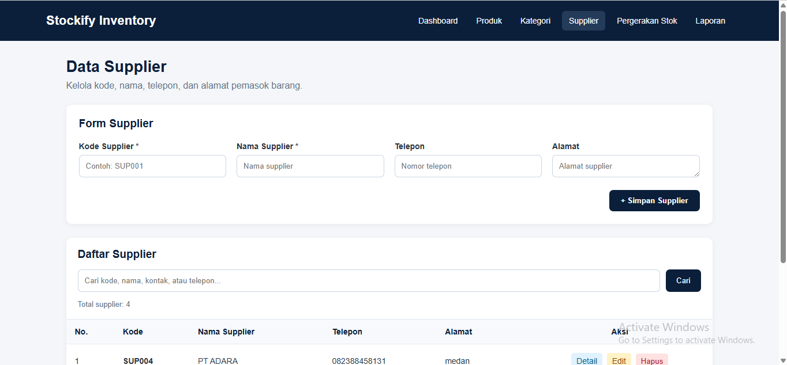
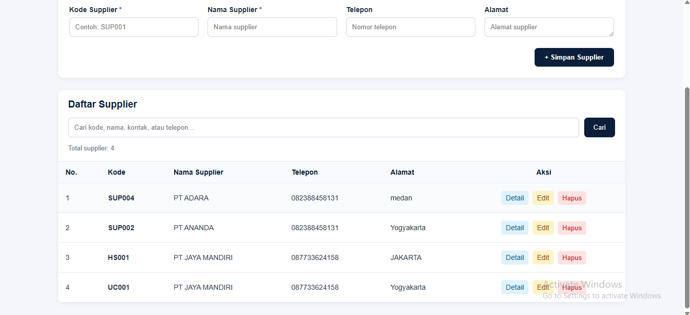
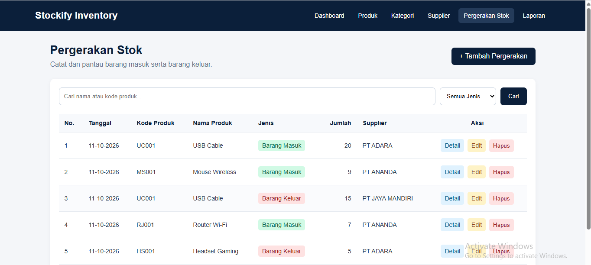
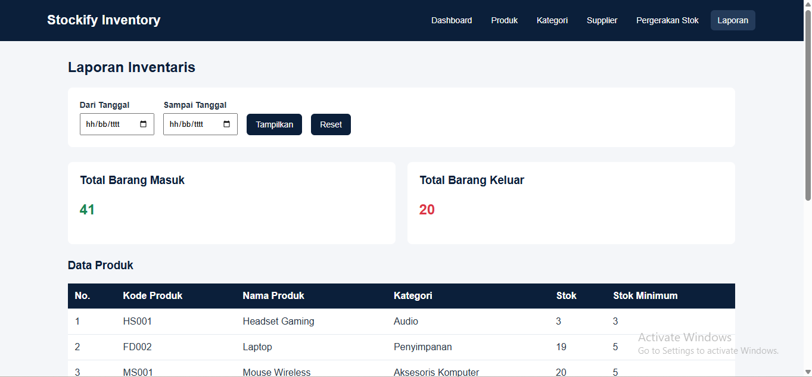
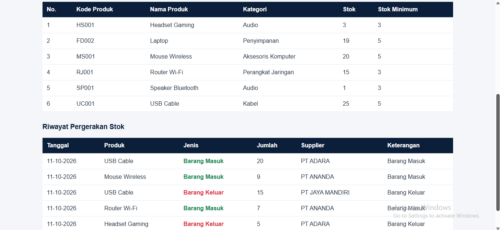

# Stockify — Inventory Management System

Aplikasi manajemen inventaris berbasis web yang dibangun menggunakan Laravel dan MySQL. Stockify membantu pengguna mengelola data produk, kategori, supplier, serta mencatat pergerakan stok masuk dan keluar.

## ✨ Fitur Utama

- **Dashboard** — Menampilkan ringkasan data inventaris.
- **Manajemen Produk** — Menambah, melihat, mengubah, mencari, dan menghapus produk.
- **Manajemen Kategori** — Mengelola kategori barang.
- **Manajemen Supplier** — Mengelola informasi pemasok.
- **Pergerakan Stok** — Mencatat transaksi stok masuk dan stok keluar.
- **Laporan** — Melihat data produk dan riwayat pergerakan stok berdasarkan periode.
- **Validasi Data** — Memeriksa data yang dimasukkan melalui formulir aplikasi.

## 🛠️ Teknologi

- PHP
- Laravel
- MySQL
- Blade Template
- HTML dan CSS
- XAMPP
- Composer

## 📸 Screenshot Aplikasi

### 1. Dashboard

Menampilkan ringkasan inventaris dan informasi stok.





### 2. Manajemen Produk

Halaman daftar produk dan pengelolaan data barang.



### 3. Manajemen Kategori

Halaman pengelolaan kategori barang.




### 4. Manajemen Supplier

Halaman untuk melihat dan mengelola data supplier.





### 5. Pergerakan Stok

Halaman pencatatan dan pemantauan stok masuk maupun stok keluar.



### 6. Laporan

Halaman laporan produk dan pergerakan stok.





### 7. Pengelolaan Data Produk

Contoh tampilan ketika menghapus, menambahkan, mencari, dan mengedit produk.

**Produk sebelum dihapus**


**Konfirmasi atau hasil penghapusan produk**


**Form tambah produk**


**Pencarian produk**


**Edit produk**


## ⚙️ Instalasi dan Menjalankan Aplikasi

### Persyaratan

Pastikan perangkat sudah memiliki PHP, Composer, MySQL, dan XAMPP.

### Langkah 1 — Clone repository

```bash
git clone https://github.com/AnandaElfira15/stockify-laravel.git
cd stockify-laravel
```

### Langkah 2 — Instal dependensi

```bash
composer install
```

### Langkah 3 — Siapkan file environment

```bash
cp .env.example .env
```

Di Windows PowerShell, perintah alternatifnya:

```powershell
Copy-Item .env.example .env
```

### Langkah 4 — Buat application key

```bash
php artisan key:generate
```

### Langkah 5 — Siapkan database

Jalankan MySQL melalui XAMPP, lalu buat database bernama `stockify_laravel`.

Sesuaikan konfigurasi database di file `.env`:

```env
DB_CONNECTION=mysql
DB_HOST=127.0.0.1
DB_PORT=3306
DB_DATABASE=stockify_laravel
DB_USERNAME=root
DB_PASSWORD=
```

Sesuaikan nama pengguna dan kata sandi jika konfigurasi MySQL kamu berbeda.

### Langkah 6 — Jalankan migration dan seeder

```bash
php artisan migrate --seed
```

**Catatan:** Perintah ini ditujukan untuk database baru atau database yang sudah dipersiapkan sesuai migration dan seeder proyek. Jangan menjalankan `migrate:fresh` pada database yang berisi data penting karena perintah tersebut menghapus tabel terlebih dahulu.

### Langkah 7 — Jalankan aplikasi

```bash
php artisan serve
```

Buka aplikasi melalui:

http://127.0.0.1:8000

## 📁 Struktur Folder

```text
stockify-laravel/
├── app/
│   ├── Http/Controllers/
│   └── Models/
├── database/
│   ├── migrations/
│   └── seeders/
├── resources/
│   └── views/
├── routes/
│   └── web.php
├── Screenshot/
└── README.md
```

## 🎯 Tujuan Proyek

Proyek ini dibuat sebagai latihan pengembangan aplikasi web menggunakan Laravel, termasuk penerapan migration, model, controller, routing, Blade, relasi database, dan operasi CRUD.

## 👩‍💻 Repository

GitHub: https://github.com/AnandaElfira15/stockify-laravel
